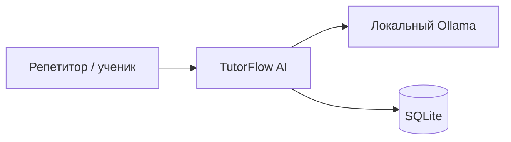
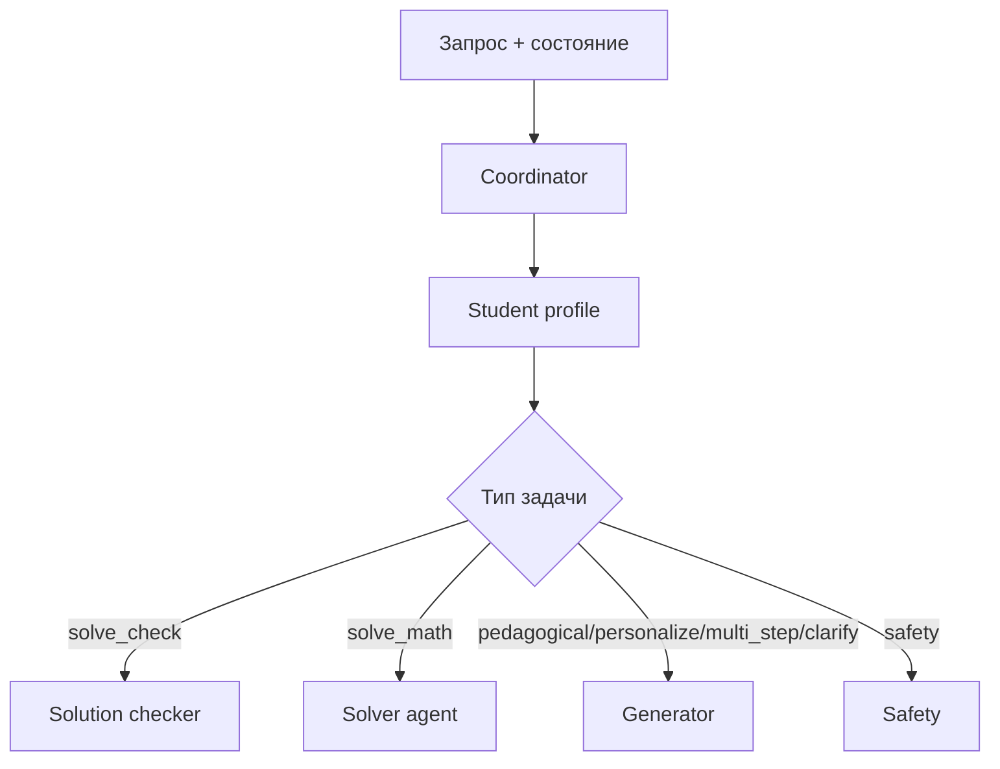
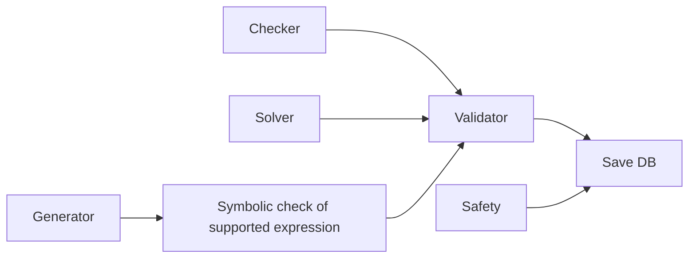
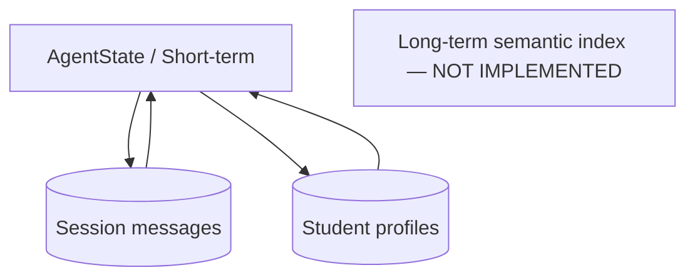
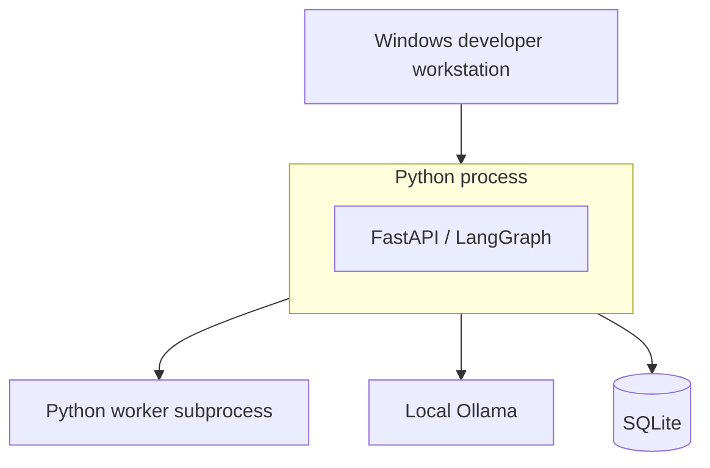
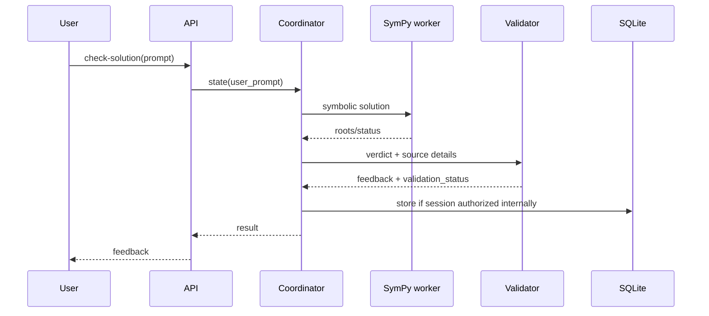

# Черновик архитектурных схем TutorFlow AI (не окончательные 7 C4 преподавателя)

Схемы фиксируют только компоненты, обнаруженные в исправленной копии. Полноценную C4 нотацию, развёртывание и семь отдельных диаграмм нужно согласовать с ТЗ и реальной средой; здесь не утверждается, что требования диаграмм уже выполнены.

## System Context



## Container (фактически процессы)

```mermaid
flowchart TD
    client[HTTP клиент] --> fastapi[FastAPI]
    fastapi --> graph[LangGraph runtime]
    graph --> worker[Дочерний Python/SymPy worker]
    graph --> models[Ollama HTTP API]
    graph --> sqlite[(SQLite)]
    graph --> logs[JSONL локальные события]
```

## Component: Coordinator & Routes



## Component: Verification & Persistence



## Memory Layer (actual vs proposed)



## Deployment (development only)



## Dynamic: Check Solution



**Ограничения текущего состояния:** Нет полноценного контроля доступа к профилям, нет VM/MicroVM, нет готового графического пакета из 7 согласованных C4-диаграмм, нет SLA для событий наблюдаемости и нет автоматической L3 памяти. Диаграмма динамики показывает концептуальный flow, а не результаты реального запущенного сервиса.
